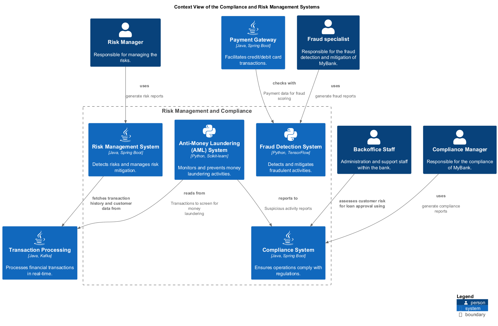

# Compliance System (System)
## Description
Ensures operations comply with regulations.

## Parent
[Risk Management and Compliance](../../mybank/compliance/context-boundary.md)

## Technology
Java, Spring Boot

## Responsibility of Organization Unit
| Org-unit | Description |
|---|---|
| [Regulations](../../mybank/compliance/regulations-unit.md) | Responsible for the compliance and regulations |
## Incoming Synchronous Requests 
| From | Name | To | Technology | Description |
|---|---|---|---|---|
| [Backoffice Staff](../../mybank/core-banking/backoffice-staff.md) | assesses customer risk for loan approval using | [Compliance System](../../mybank/compliance/compliance-system.md) |  |  |
| [Compliance Manager](../../mybank/compliance/compliance-manager.md) | uses | [Compliance System](../../mybank/compliance/compliance-system.md) |  | generate compliance reports |
## Incoming Asynchronous Sends
| From | Name | To | Technology | Description |
|---|---|---|---|---|
| [Anti-Money Laundering (AML) System](../../mybank/compliance/aml-system.md) | reports to | [Compliance System](../../mybank/compliance/compliance-system.md) |  | Suspicious activity reports |

## System Context View

[Context View of the Compliance and Risk Management Systems](../../mybank/compliance/context-view.md)

## Navigation
[List of views in namespace](./views-in-namespace.md)

[List of all Views](../../views.md)

(generated by [Overarch](https://github.com/soulspace-org/overarch) with template docs/node.md.cmb)
