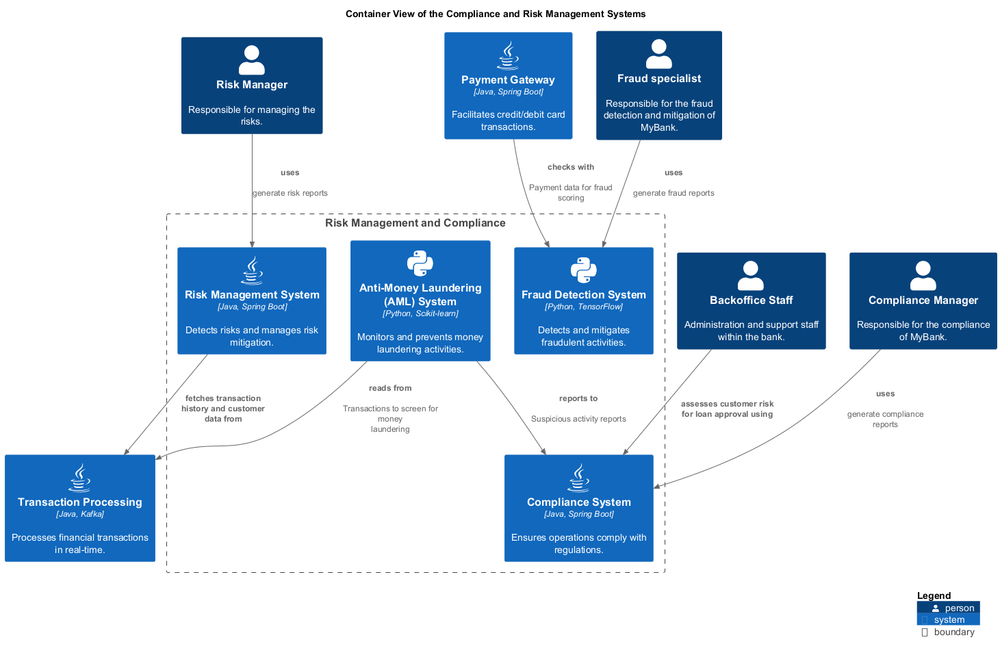

# Container View of the Compliance and Risk Management Systems

## Diagram

## Description
Shows the systems and containers of the domain Compliance and Risk Management and their relations.

## Subdomains/Bounded Contexts
| Subdomain/Bounded Context | Description |
|---|---|
| [Risk Management and Compliance](../../mybank/compliance/context-boundary.md)| Detects and mitigates risks, ensuring regulatory compliance. |

## Roles
| Person/Role | Description |
|---|---|
| [Backoffice Staff](../../mybank/core-banking/backoffice-staff.md)| Administration and support staff within the bank. |
| [Compliance Manager](../../mybank/compliance/compliance-manager.md)| Responsible for the compliance of MyBank. |
| [Fraud specialist](../../mybank/compliance/fraud-specialist.md)| Responsible for the fraud detection and mitigation of MyBank. |
| [Risk Manager](../../mybank/compliance/risk-manager.md)| Responsible for managing the risks. |

## Systems
| System | Description |
|---|---|
| [Anti-Money Laundering (AML) System](../../mybank/compliance/aml-system.md)| Monitors and prevents money laundering activities. |
| [Compliance System](../../mybank/compliance/compliance-system.md)| Ensures operations comply with regulations. |
| [Fraud Detection System](../../mybank/compliance/fraud-detection-system.md)| Detects and mitigates fraudulent activities. |
| [Payment Gateway](../../mybank/payment/payment-gateway-system.md)| Facilitates credit/debit card transactions. |
| [Risk Management System](../../mybank/compliance/risk-management-system.md)| Detects risks and manages risk mitigation. |
| [Transaction Processing](../../mybank/core-banking/transaction-processing-system.md)| Processes financial transactions in real-time. |

## Synchronous Requests
| From | Name | To | Technology | Description |
|---|---|---|---|---|
| [Payment Gateway](../../mybank/payment/payment-gateway-system.md) | checks with | [Fraud Detection System](../../mybank/compliance/fraud-detection-system.md) |  | Payment data for fraud scoring |
| [Risk Management System](../../mybank/compliance/risk-management-system.md) | fetches transaction history and customer data from | [Transaction Processing](../../mybank/core-banking/transaction-processing-system.md) |  |  |
| [Anti-Money Laundering (AML) System](../../mybank/compliance/aml-system.md) | reads from | [Transaction Processing](../../mybank/core-banking/transaction-processing-system.md) |  | Transactions to screen for money laundering |
| [Compliance Manager](../../mybank/compliance/compliance-manager.md) | uses | [Compliance System](../../mybank/compliance/compliance-system.md) |  | generate compliance reports |
| [Fraud specialist](../../mybank/compliance/fraud-specialist.md) | uses | [Fraud Detection System](../../mybank/compliance/fraud-detection-system.md) |  | generate fraud reports |
| [Risk Manager](../../mybank/compliance/risk-manager.md) | uses | [Risk Management System](../../mybank/compliance/risk-management-system.md) |  | generate risk reports |

## Other Relationships
| From | Name | To | Description |
|---|---|---|---|
| [Backoffice Staff](../../mybank/core-banking/backoffice-staff.md) | assesses customer risk for loan approval using | [Compliance System](../../mybank/compliance/compliance-system.md) |  |

## Navigation
[List of views in namespace](./views-in-namespace.md)

[List of all Views](../../views.md)

(generated by [Overarch](https://github.com/soulspace-org/overarch) with template docs/view.md.cmb)

