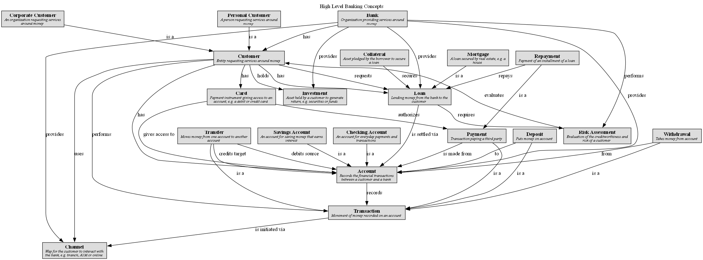

# Risk Assessment (Concept)
## Description
Evaluation of the creditworthiness and risk of a customer

## Other Relations
| From | Name | To | Description |
|---|---|---|---|
| [Risk Assessment](../../mybank/concepts/risk-assessment.md) | evaluates | [Customer](../../mybank/concepts/customer.md) |  |
| [Bank](../../mybank/concepts/bank.md) | performs | [Risk Assessment](../../mybank/concepts/risk-assessment.md) |  |
| [Loan](../../mybank/concepts/loan.md) | requires | [Risk Assessment](../../mybank/concepts/risk-assessment.md) |  |

## Concept Map

[High Level Banking Concepts](../../mybank/concepts/concept-view.md)

## Navigation
[List of views in namespace](./views-in-namespace.md)

[List of all Views](../../views.md)

(generated by [Overarch](https://github.com/soulspace-org/overarch) with template docs/node.md.cmb)
