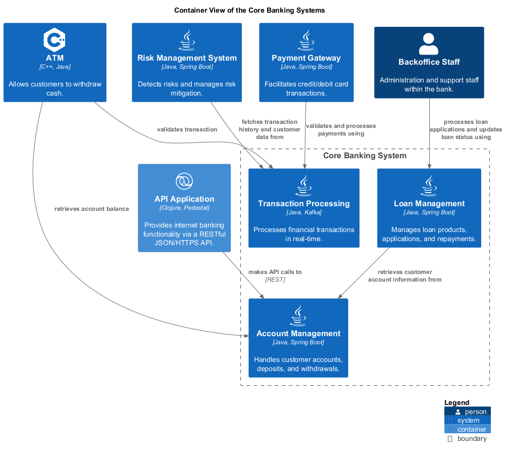

# Core Banking System (Context-boundary)
## Description
Manages customer accounts, transactions, and loans.

## Parent
[My Bank](../../mybank/mybank-plc.md)
## Systems
| System | Description |
|---|---|
| [Account Management](../../mybank/core-banking/account-management-system.md) | Handles customer accounts, deposits, and withdrawals. |
| [Loan Management](../../mybank/core-banking/loan-management-system.md) | Manages loan products, applications, and repayments. |
| [Transaction Processing](../../mybank/core-banking/transaction-processing-system.md) | Processes financial transactions in real-time. |

## Container View

[Container View of the Core Banking Systems](../../mybank/core-banking/container-view.md)

## Navigation
[List of views in namespace](./views-in-namespace.md)

[List of all Views](../../views.md)

(generated by [Overarch](https://github.com/soulspace-org/overarch) with template docs/node.md.cmb)
