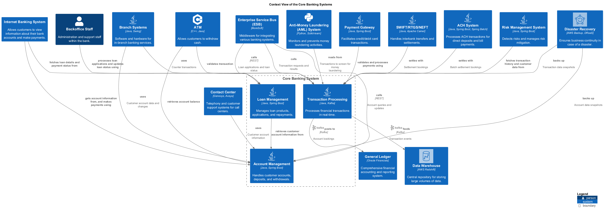

# Context View of the Core Banking Systems

## Diagram

## Description
Shows the systems of the domain Core Banking and their relations.

## Subdomains/Bounded Contexts
| Subdomain/Bounded Context | Description |
|---|---|
| [Core Banking System](../../mybank/core-banking/context-boundary.md)| Manages customer accounts, transactions, and loans. |

## Roles
| Person/Role | Description |
|---|---|
| [Backoffice Staff](../../mybank/core-banking/backoffice-staff.md)| Administration and support staff within the bank. |

## Systems
| System | Description |
|---|---|
| [ACH System](../../mybank/payment/ach-system.md)| Processes ACH transactions for direct deposits and bill payments. |
| [ATM](../../mybank/customer-channels/atm.md)| Allows customers to withdraw cash. |
| [Account Management](../../mybank/core-banking/account-management-system.md)| Handles customer accounts, deposits, and withdrawals. |
| [Anti-Money Laundering (AML) System](../../mybank/compliance/aml-system.md)| Monitors and prevents money laundering activities. |
| [Branch Systems](../../mybank/customer-channels/branch-systems.md)| Software and hardware for in-branch banking services. |
| [Contact Center](../../mybank/customer-channels/contact-center-system.md)| Telephony and customer support systems for call centers. |
| [Data Warehouse](../../mybank/data-management/data-warehouse-system.md)| Central repository for storing large volumes of data. |
| [Disaster Recovery](../../mybank/security/disaster-recovery-system.md)| Ensures business continuity in case of a disaster. |
| [Enterprise Service Bus (ESB)](../../mybank/integration-middleware/esb.md)| Middleware for integrating various banking systems. |
| [General Ledger](../../mybank/financial-management/general-ledger-system.md)| Comprehensive financial accounting and reporting system. |
| [Internet Banking System](../../mybank/digital-banking/internet-banking-system/internet-banking-system.md)| Allows customers to view information about their bank accounts and make payments. |
| [Loan Management](../../mybank/core-banking/loan-management-system.md)| Manages loan products, applications, and repayments. |
| [Payment Gateway](../../mybank/payment/payment-gateway-system.md)| Facilitates credit/debit card transactions. |
| [Risk Management System](../../mybank/compliance/risk-management-system.md)| Detects risks and manages risk mitigation. |
| [SWIFT/RTGS/NEFT](../../mybank/payment/swift-rtgs-neft-system.md)| Handles interbank transfers and settlements. |
| [Transaction Processing](../../mybank/core-banking/transaction-processing-system.md)| Processes financial transactions in real-time. |

## Synchronous Requests
| From | Name | To | Technology | Description |
|---|---|---|---|---|
| [Disaster Recovery](../../mybank/security/disaster-recovery-system.md) | backs up | [Transaction Processing](../../mybank/core-banking/transaction-processing-system.md) |  | Transaction data snapshots |
| [Disaster Recovery](../../mybank/security/disaster-recovery-system.md) | backs up | [Account Management](../../mybank/core-banking/account-management-system.md) |  | Account data snapshots |
| [Enterprise Service Bus (ESB)](../../mybank/integration-middleware/esb.md) | calls | [Transaction Processing](../../mybank/core-banking/transaction-processing-system.md) |  | Transaction requests and results |
| [Enterprise Service Bus (ESB)](../../mybank/integration-middleware/esb.md) | calls | [Account Management](../../mybank/core-banking/account-management-system.md) | REST | Account queries and updates |
| [Enterprise Service Bus (ESB)](../../mybank/integration-middleware/esb.md) | calls | [Loan Management](../../mybank/core-banking/loan-management-system.md) | REST | Loan applications and loan status |
| [Internet Banking System](../../mybank/digital-banking/internet-banking-system/internet-banking-system.md) | fetches loan details and payment status from | [Loan Management](../../mybank/core-banking/loan-management-system.md) |  |  |
| [Risk Management System](../../mybank/compliance/risk-management-system.md) | fetches transaction history and customer data from | [Transaction Processing](../../mybank/core-banking/transaction-processing-system.md) |  |  |
| [Internet Banking System](../../mybank/digital-banking/internet-banking-system/internet-banking-system.md) | gets account information from, and makes payments using | [Account Management](../../mybank/core-banking/account-management-system.md) |  |  |
| [Backoffice Staff](../../mybank/core-banking/backoffice-staff.md) | processes loan applications and updates loan status using | [Loan Management](../../mybank/core-banking/loan-management-system.md) |  |  |
| [Anti-Money Laundering (AML) System](../../mybank/compliance/aml-system.md) | reads from | [Transaction Processing](../../mybank/core-banking/transaction-processing-system.md) |  | Transactions to screen for money laundering |
| [ATM](../../mybank/customer-channels/atm.md) | retrieves account balance | [Account Management](../../mybank/core-banking/account-management-system.md) |  |  |
| [Loan Management](../../mybank/core-banking/loan-management-system.md) | retrieves customer account information from | [Account Management](../../mybank/core-banking/account-management-system.md) |  |  |
| [SWIFT/RTGS/NEFT](../../mybank/payment/swift-rtgs-neft-system.md) | settles with | [Transaction Processing](../../mybank/core-banking/transaction-processing-system.md) |  | Settlement bookings |
| [ACH System](../../mybank/payment/ach-system.md) | settles with | [Transaction Processing](../../mybank/core-banking/transaction-processing-system.md) |  | Batch settlement bookings |
| [Contact Center](../../mybank/customer-channels/contact-center-system.md) | uses | [Account Management](../../mybank/core-banking/account-management-system.md) |  | Customer account information |
| [Branch Systems](../../mybank/customer-channels/branch-systems.md) | uses | [Transaction Processing](../../mybank/core-banking/transaction-processing-system.md) |  | Counter transactions |
| [Branch Systems](../../mybank/customer-channels/branch-systems.md) | uses | [Account Management](../../mybank/core-banking/account-management-system.md) |  | Customer account data and changes |
| [Payment Gateway](../../mybank/payment/payment-gateway-system.md) | validates and processes payments using | [Transaction Processing](../../mybank/core-banking/transaction-processing-system.md) |  |  |
| [ATM](../../mybank/customer-channels/atm.md) | validates transaction | [Transaction Processing](../../mybank/core-banking/transaction-processing-system.md) |  |  |

## Navigation
[List of views in namespace](./views-in-namespace.md)

[List of all Views](../../views.md)

(generated by [Overarch](https://github.com/soulspace-org/overarch) with template docs/view.md.cmb)

