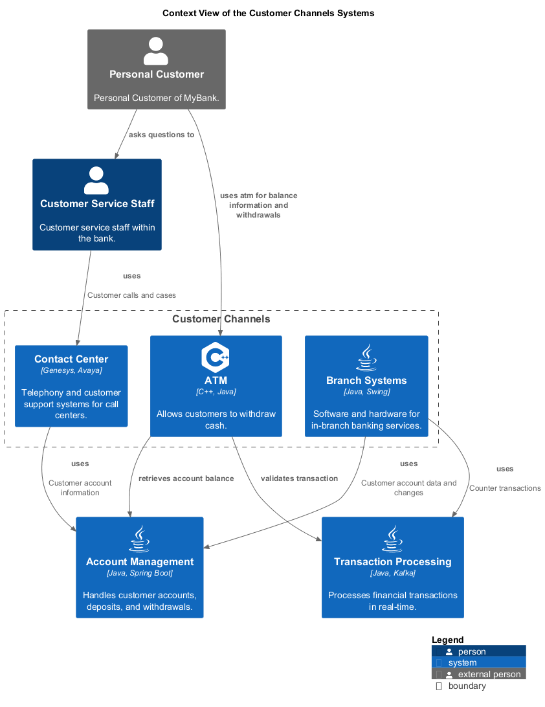

# ATM (System)
## Description
Allows customers to withdraw cash.

## Parent
[Customer Channels](../../mybank/customer-channels/context-boundary.md)

## Technology
C++, Java
## Incoming Synchronous Requests 
| From | Name | To | Technology | Description |
|---|---|---|---|---|
| [Personal Customer](../../mybank/personal-customer.md) | uses atm for balance information and withdrawals | [ATM](../../mybank/customer-channels/atm.md) |  |  |
## Outgoing Synchronous Requests 
| From | Name | To | Technology | Description |
|---|---|---|---|---|
| [ATM](../../mybank/customer-channels/atm.md) | retrieves account balance | [Account Management](../../mybank/core-banking/account-management-system.md) |  |  |
| [ATM](../../mybank/customer-channels/atm.md) | validates transaction | [Transaction Processing](../../mybank/core-banking/transaction-processing-system.md) |  |  |

## System Context View

[Context View of the Customer Channels Systems](../../mybank/customer-channels/context-view.md)

## Navigation
[List of views in namespace](./views-in-namespace.md)

[List of all Views](../../views.md)

(generated by [Overarch](https://github.com/soulspace-org/overarch) with template docs/node.md.cmb)
