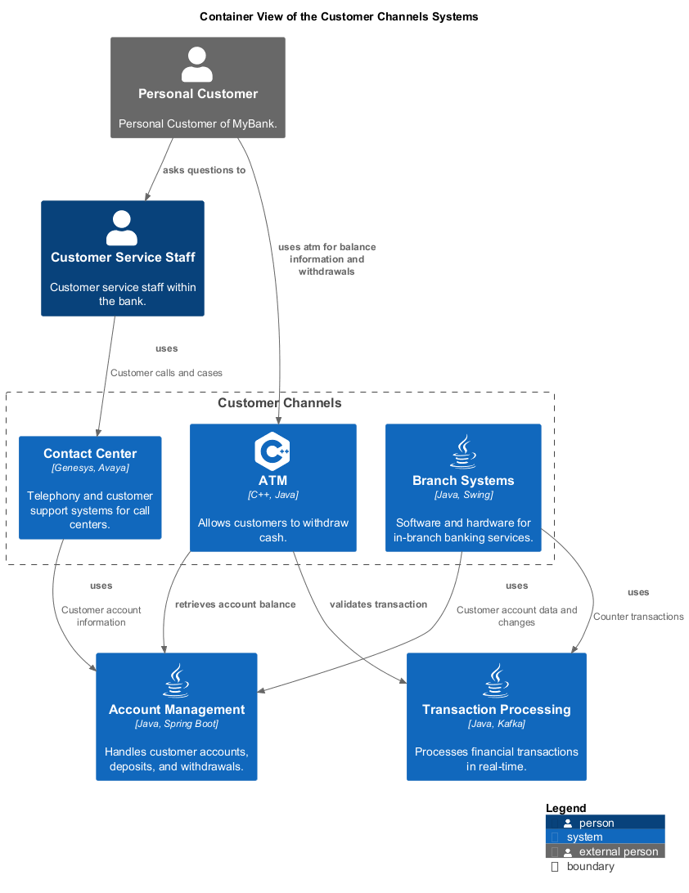

# Customer Channels (Context-boundary)
## Description
Interfaces for customer interaction, including branch systems, ATMs, and call centers.

## Parent
[My Bank](../../mybank/mybank-plc.md)
## Systems
| System | Description |
|---|---|
| [ATM](../../mybank/customer-channels/atm.md) | Allows customers to withdraw cash. |
| [Branch Systems](../../mybank/customer-channels/branch-systems.md) | Software and hardware for in-branch banking services. |
| [Contact Center](../../mybank/customer-channels/contact-center-system.md) | Telephony and customer support systems for call centers. |

## Container View

[Container View of the Customer Channels Systems](../../mybank/customer-channels/container-view.md)

## Navigation
[List of views in namespace](./views-in-namespace.md)

[List of all Views](../../views.md)

(generated by [Overarch](https://github.com/soulspace-org/overarch) with template docs/node.md.cmb)
