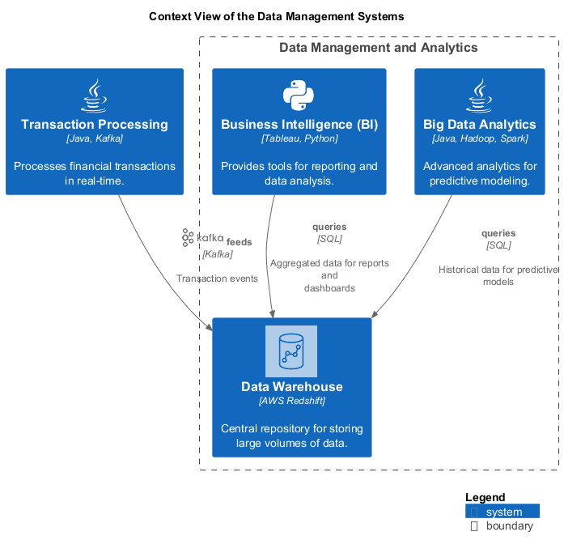

# Context View of the Data Management Systems

## Diagram

## Description
Shows the systems of the domain Data Management and their relations.

## Subdomains/Bounded Contexts
| Subdomain/Bounded Context | Description |
|---|---|
| [Data Management and Analytics](../../mybank/data-management/context-boundary.md)| Manages data storage, warehousing, and analytics. |

## Systems
| System | Description |
|---|---|
| [Big Data Analytics](../../mybank/data-management/big-data-analytics-system.md)| Advanced analytics for predictive modeling. |
| [Business Intelligence (BI)](../../mybank/data-management/business-intelligence-system.md)| Provides tools for reporting and data analysis. |
| [Data Warehouse](../../mybank/data-management/data-warehouse-system.md)| Central repository for storing large volumes of data. |
| [Transaction Processing](../../mybank/core-banking/transaction-processing-system.md)| Processes financial transactions in real-time. |

## Synchronous Requests
| From | Name | To | Technology | Description |
|---|---|---|---|---|
| [Business Intelligence (BI)](../../mybank/data-management/business-intelligence-system.md) | queries | [Data Warehouse](../../mybank/data-management/data-warehouse-system.md) | SQL | Aggregated data for reports and dashboards |
| [Big Data Analytics](../../mybank/data-management/big-data-analytics-system.md) | queries | [Data Warehouse](../../mybank/data-management/data-warehouse-system.md) | SQL | Historical data for predictive models |

## Navigation
[List of views in namespace](./views-in-namespace.md)

[List of all Views](../../views.md)

(generated by [Overarch](https://github.com/soulspace-org/overarch) with template docs/view.md.cmb)

