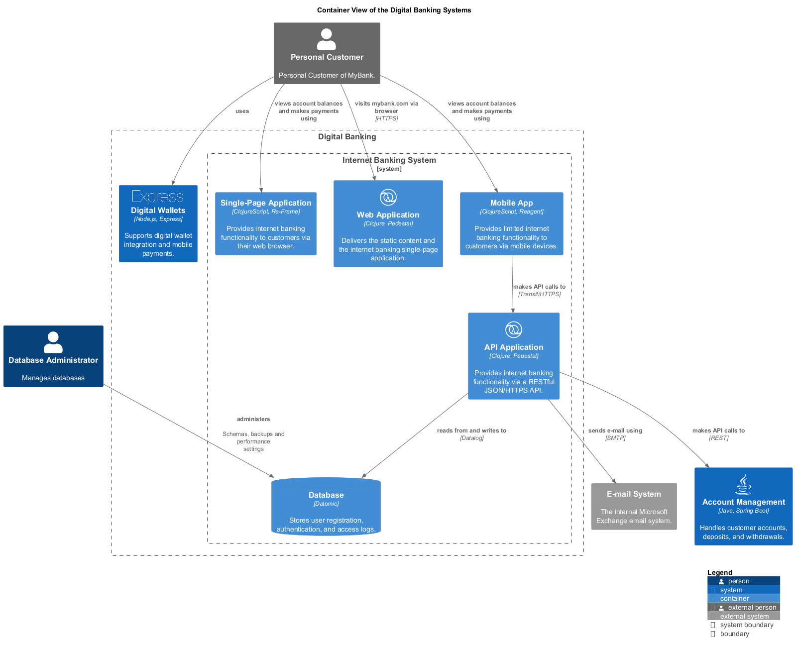

# Digital Banking (Context-boundary)
## Description
Enables online and mobile banking services for customers.

## Parent
[My Bank](../../mybank/mybank-plc.md)
## Systems
| System | Description |
|---|---|
| [Digital Wallets](../../mybank/digital-banking/digital-wallets-system.md) | Supports digital wallet integration and mobile payments. |
| [Internet Banking System](../../mybank/digital-banking/internet-banking-system/internet-banking-system.md) | Allows customers to view information about their bank accounts and make payments. |

## Container View

[Container View of the Digital Banking Systems](../../mybank/digital-banking/container-view.md)

## Navigation
[List of views in namespace](./views-in-namespace.md)

[List of all Views](../../views.md)

(generated by [Overarch](https://github.com/soulspace-org/overarch) with template docs/node.md.cmb)
