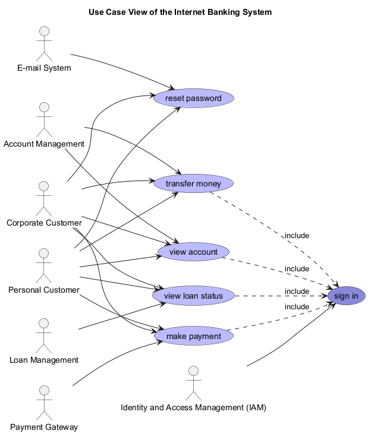

# sign in (Use-case)
## Description
authenticate to the internet banking system

## Actors
| Actor | Description |
|---|---|
| [Identity and Access Management (IAM)](../../../mybank/security/identity-access-management-system.md) | Manages secure access to systems and data. |
## Including Use Cases
| Use Case | Description |
|---|---|
| [make payment](../../../mybank/digital-banking/internet-banking-system/make-payment.md) | pay a third party from an account |
| [transfer money](../../../mybank/digital-banking/internet-banking-system/transfer-money.md) | transfer money from one account to another |
| [view account](../../../mybank/digital-banking/internet-banking-system/view-account.md) | view the details of an account |
| [view loan status](../../../mybank/digital-banking/internet-banking-system/view-loan-status.md) | view the details and payment status of a loan |

## Use Case View

[Use Case View of the Internet Banking System](../../../mybank/digital-banking/internet-banking-system/use-case-view.md)

## Navigation
[List of views in namespace](./views-in-namespace.md)

[List of all Views](../../../views.md)

(generated by [Overarch](https://github.com/soulspace-org/overarch) with template docs/node.md.cmb)
