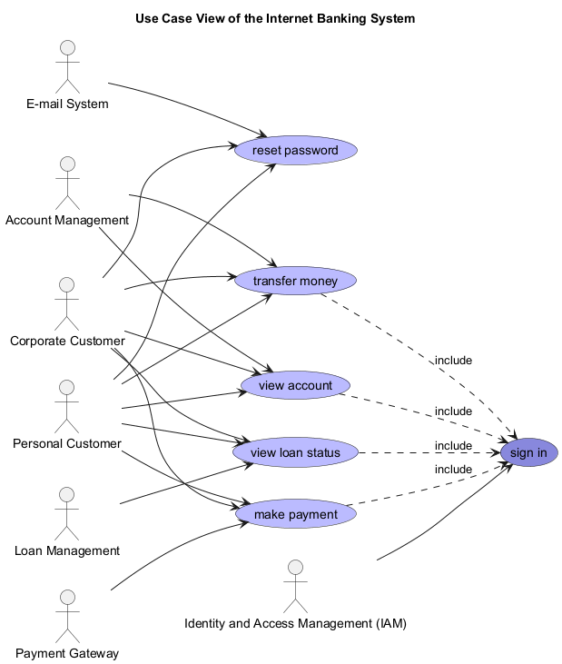

# transfer money (Use-case)
## Description
transfer money from one account to another

## Actors
| Actor | Description |
|---|---|
| [Account Management](../../../mybank/core-banking/account-management-system.md) | Handles customer accounts, deposits, and withdrawals. |
| [Corporate Customer](../../../mybank/corporate-customer.md) | Corporate Customer of MyBank. |
| [Personal Customer](../../../mybank/personal-customer.md) | Personal Customer of MyBank. |

## Use Case View

[Use Case View of the Internet Banking System](../../../mybank/digital-banking/internet-banking-system/use-case-view.md)

## Navigation
[List of views in namespace](./views-in-namespace.md)

[List of all Views](../../../views.md)

(generated by [Overarch](https://github.com/soulspace-org/overarch) with template docs/node.md.cmb)
