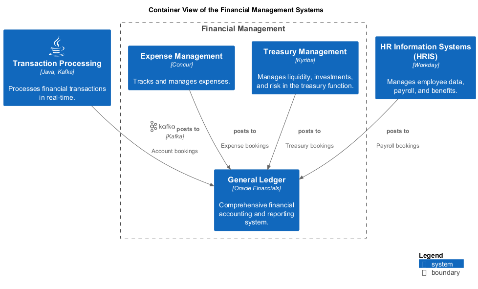

# Financial Management (Context-boundary)
## Description
Handles financial accounting, treasury, and expense management.

## Parent
[My Bank](../../mybank/mybank-plc.md)
## Systems
| System | Description |
|---|---|
| [Expense Management](../../mybank/financial-management/expense-management-system.md) | Tracks and manages expenses. |
| [General Ledger](../../mybank/financial-management/general-ledger-system.md) | Comprehensive financial accounting and reporting system. |
| [Treasury Management](../../mybank/financial-management/treasury-management-system.md) | Manages liquidity, investments, and risk in the treasury function. |

## Container View

[Container View of the Financial Management Systems](../../mybank/financial-management/container-view.md)

## Navigation
[List of views in namespace](./views-in-namespace.md)

[List of all Views](../../views.md)

(generated by [Overarch](https://github.com/soulspace-org/overarch) with template docs/node.md.cmb)
