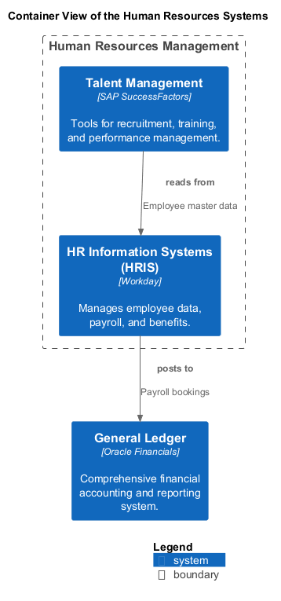

# Human Resources Management (Context-boundary)
## Description
Manages employee information, payroll, and talent management.

## Parent
[My Bank](../../mybank/mybank-plc.md)
## Systems
| System | Description |
|---|---|
| [HR Information Systems (HRIS)](../../mybank/human-resources/hris.md) | Manages employee data, payroll, and benefits. |
| [Talent Management](../../mybank/human-resources/talent-management-system.md) | Tools for recruitment, training, and performance management. |

## Container View

[Container View of the Human Resources Systems](../../mybank/human-resources/container-view.md)

## Navigation
[List of views in namespace](./views-in-namespace.md)

[List of all Views](../../views.md)

(generated by [Overarch](https://github.com/soulspace-org/overarch) with template docs/node.md.cmb)
