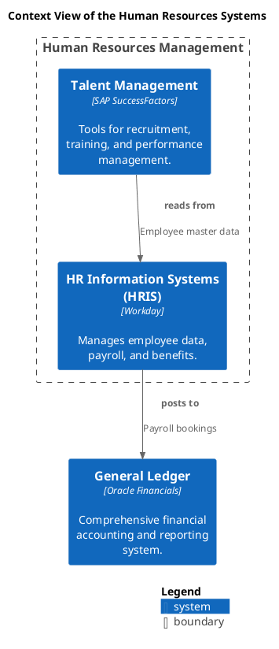

# HR Information Systems (HRIS) (System)
## Description
Manages employee data, payroll, and benefits.

## Parent
[Human Resources Management](../../mybank/human-resources/context-boundary.md)

## Technology
Workday
## Incoming Synchronous Requests 
| From | Name | To | Technology | Description |
|---|---|---|---|---|
| [Talent Management](../../mybank/human-resources/talent-management-system.md) | reads from | [HR Information Systems (HRIS)](../../mybank/human-resources/hris.md) |  | Employee master data |
## Outgoing Asynchronous Sends
| From | Name | To | Technology | Description |
|---|---|---|---|---|
| [HR Information Systems (HRIS)](../../mybank/human-resources/hris.md) | posts to | [General Ledger](../../mybank/financial-management/general-ledger-system.md) |  | Payroll bookings |

## System Context View

[Context View of the Human Resources Systems](../../mybank/human-resources/context-view.md)

## Navigation
[List of views in namespace](./views-in-namespace.md)

[List of all Views](../../views.md)

(generated by [Overarch](https://github.com/soulspace-org/overarch) with template docs/node.md.cmb)
