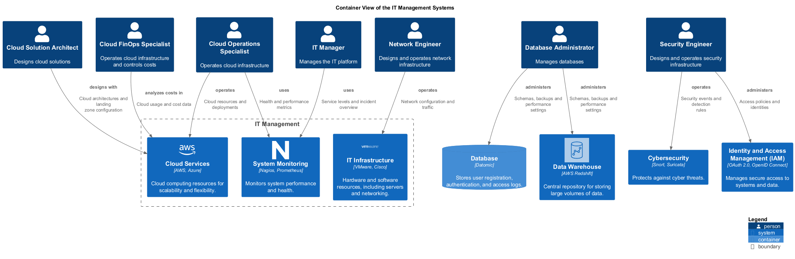

# Container View of the IT Management Systems

## Diagram

## Description
Shows the systems and containers of the domain IT management and their relations.

## Subdomains/Bounded Contexts
| Subdomain/Bounded Context | Description |
|---|---|
| [IT Management](../../mybank/it-management/context-boundary.md)| Manages IT infrastructure, cloud resources, and system monitoring. |

## Roles
| Person/Role | Description |
|---|---|
| [Cloud FinOps Specialist](../../mybank/it-management/cloud-finops-specialist.md)| Operates cloud infrastructure and controls costs |
| [Cloud Operations Specialist](../../mybank/it-management/cloud-operations-specialist.md)| Operates cloud infrastructure |
| [Cloud Solution Architect](../../mybank/it-management/cloud-solution-architect.md)| Designs cloud solutions |
| [Database Administrator](../../mybank/it-management/database-administrator.md)| Manages databases |
| [IT Manager](../../mybank/it-management/it-manager.md)| Manages the IT platform |
| [Network Engineer](../../mybank/it-management/network-engineer.md)| Designs and operates network infrastructure |
| [Security Engineer](../../mybank/it-management/security-engineer.md)| Designs and operates security infrastructure |

## Systems
| System | Description |
|---|---|
| [Cloud Services](../../mybank/infrastructure-management/cloud-services-system.md)| Cloud computing resources for scalability and flexibility. |
| [Cybersecurity](../../mybank/security/cybersecurity-system.md)| Protects against cyber threats. |
| [Data Warehouse](../../mybank/data-management/data-warehouse-system.md)| Central repository for storing large volumes of data. |
| [IT Infrastructure](../../mybank/infrastructure-management/it-infrastructure-system.md)| Hardware and software resources, including servers and networking. |
| [Identity and Access Management (IAM)](../../mybank/security/identity-access-management-system.md)| Manages secure access to systems and data. |
| [System Monitoring](../../mybank/infrastructure-management/system-monitoring-system.md)| Monitors system performance and health. |

## Containers
| Container | Description |
|---|---|
| [Database](../../mybank/digital-banking/internet-banking-system/database.md)| Stores user registration, authentication, and access logs. |

## Synchronous Requests
| From | Name | To | Technology | Description |
|---|---|---|---|---|
| [Security Engineer](../../mybank/it-management/security-engineer.md) | administers | [Identity and Access Management (IAM)](../../mybank/security/identity-access-management-system.md) |  | Access policies and identities |
| [Database Administrator](../../mybank/it-management/database-administrator.md) | administers | [Data Warehouse](../../mybank/data-management/data-warehouse-system.md) |  | Schemas, backups and performance settings |
| [Database Administrator](../../mybank/it-management/database-administrator.md) | administers | [Database](../../mybank/digital-banking/internet-banking-system/database.md) |  | Schemas, backups and performance settings |
| [Cloud FinOps Specialist](../../mybank/it-management/cloud-finops-specialist.md) | analyzes costs in | [Cloud Services](../../mybank/infrastructure-management/cloud-services-system.md) |  | Cloud usage and cost data |
| [Cloud Solution Architect](../../mybank/it-management/cloud-solution-architect.md) | designs with | [Cloud Services](../../mybank/infrastructure-management/cloud-services-system.md) |  | Cloud architectures and landing zone configuration |
| [Network Engineer](../../mybank/it-management/network-engineer.md) | operates | [IT Infrastructure](../../mybank/infrastructure-management/it-infrastructure-system.md) |  | Network configuration and traffic |
| [Security Engineer](../../mybank/it-management/security-engineer.md) | operates | [Cybersecurity](../../mybank/security/cybersecurity-system.md) |  | Security events and detection rules |
| [Cloud Operations Specialist](../../mybank/it-management/cloud-operations-specialist.md) | operates | [Cloud Services](../../mybank/infrastructure-management/cloud-services-system.md) |  | Cloud resources and deployments |
| [Cloud Operations Specialist](../../mybank/it-management/cloud-operations-specialist.md) | uses | [System Monitoring](../../mybank/infrastructure-management/system-monitoring-system.md) |  | Health and performance metrics |
| [IT Manager](../../mybank/it-management/it-manager.md) | uses | [System Monitoring](../../mybank/infrastructure-management/system-monitoring-system.md) |  | Service levels and incident overview |

## Navigation
[List of views in namespace](./views-in-namespace.md)

[List of all Views](../../views.md)

(generated by [Overarch](https://github.com/soulspace-org/overarch) with template docs/view.md.cmb)

