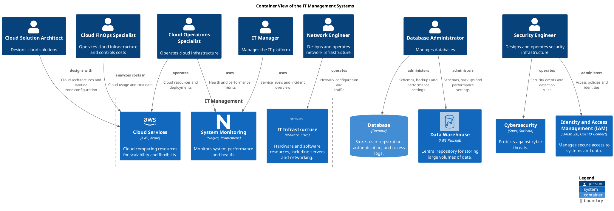

# IT Management (Context-boundary)
## Description
Manages IT infrastructure, cloud resources, and system monitoring.

## Parent
[My Bank](../../mybank/mybank-plc.md)
## Systems
| System | Description |
|---|---|
| [Cloud Services](../../mybank/infrastructure-management/cloud-services-system.md) | Cloud computing resources for scalability and flexibility. |
| [IT Infrastructure](../../mybank/infrastructure-management/it-infrastructure-system.md) | Hardware and software resources, including servers and networking. |
| [System Monitoring](../../mybank/infrastructure-management/system-monitoring-system.md) | Monitors system performance and health. |

## Container View

[Container View of the IT Management Systems](../../mybank/it-management/container-view.md)

## Navigation
[List of views in namespace](./views-in-namespace.md)

[List of all Views](../../views.md)

(generated by [Overarch](https://github.com/soulspace-org/overarch) with template docs/node.md.cmb)
