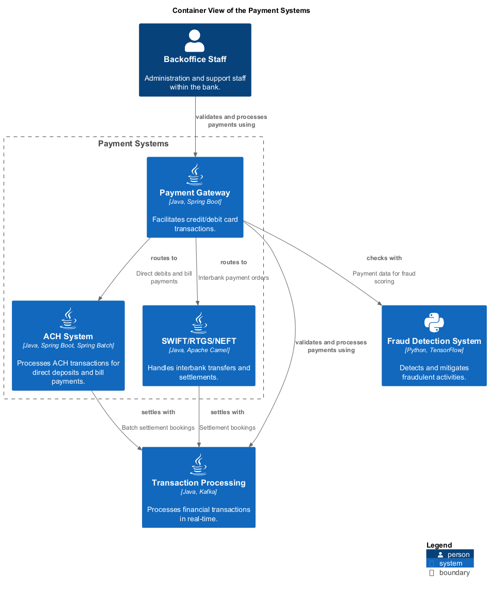

# Payment Systems (Context-boundary)
## Description
Manages interbank payments, ACH, and SWIFT transactions.

## Parent
[My Bank](../../mybank/mybank-plc.md)
## Systems
| System | Description |
|---|---|
| [ACH System](../../mybank/payment/ach-system.md) | Processes ACH transactions for direct deposits and bill payments. |
| [Payment Gateway](../../mybank/payment/payment-gateway-system.md) | Facilitates credit/debit card transactions. |
| [SWIFT/RTGS/NEFT](../../mybank/payment/swift-rtgs-neft-system.md) | Handles interbank transfers and settlements. |

## Container View

[Container View of the Payment Systems](../../mybank/payment/container-view.md)

## Navigation
[List of views in namespace](./views-in-namespace.md)

[List of all Views](../../views.md)

(generated by [Overarch](https://github.com/soulspace-org/overarch) with template docs/node.md.cmb)
