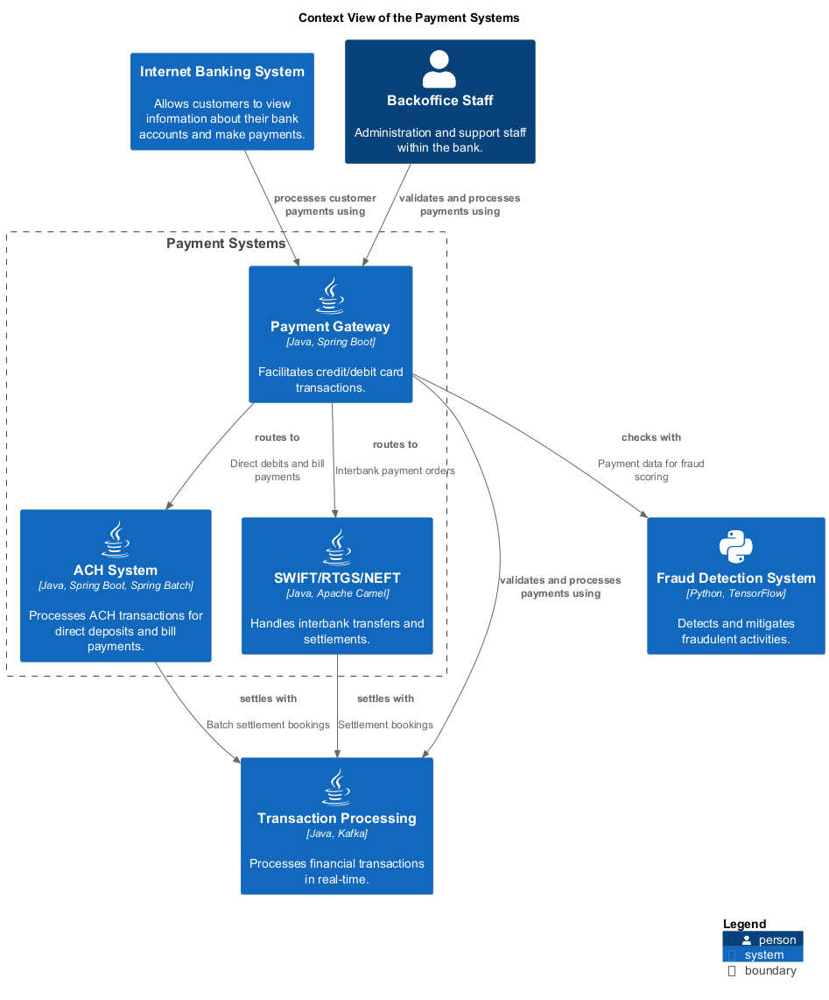

# SWIFT/RTGS/NEFT (System)
## Description
Handles interbank transfers and settlements.

## Parent
[Payment Systems](../../mybank/payment/context-boundary.md)

## Technology
Java, Apache Camel
## Incoming Synchronous Requests 
| From | Name | To | Technology | Description |
|---|---|---|---|---|
| [Payment Gateway](../../mybank/payment/payment-gateway-system.md) | routes to | [SWIFT/RTGS/NEFT](../../mybank/payment/swift-rtgs-neft-system.md) |  | Interbank payment orders |
## Outgoing Synchronous Requests 
| From | Name | To | Technology | Description |
|---|---|---|---|---|
| [SWIFT/RTGS/NEFT](../../mybank/payment/swift-rtgs-neft-system.md) | settles with | [Transaction Processing](../../mybank/core-banking/transaction-processing-system.md) |  | Settlement bookings |

## System Context View

[Context View of the Payment Systems](../../mybank/payment/context-view.md)

## Navigation
[List of views in namespace](./views-in-namespace.md)

[List of all Views](../../views.md)

(generated by [Overarch](https://github.com/soulspace-org/overarch) with template docs/node.md.cmb)
