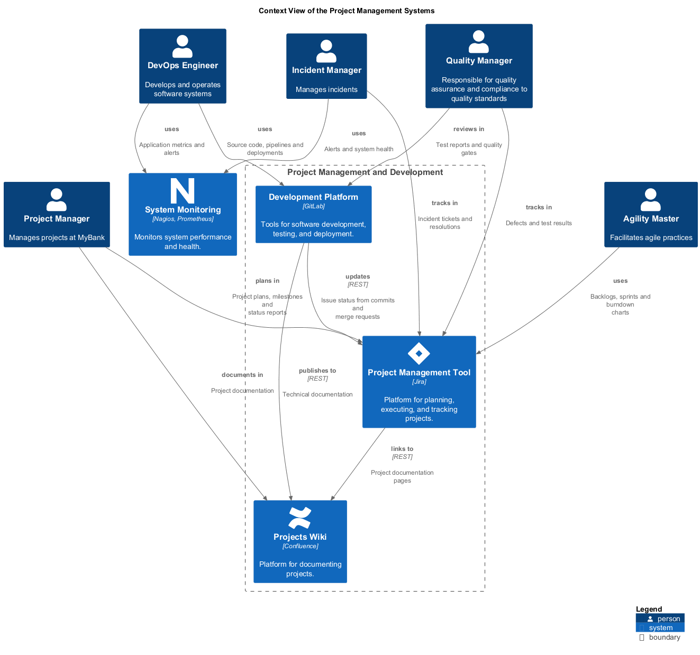

# Projects Wiki (System)
## Description
Platform for documenting projects.

## Parent
[Project Management and Development](../../mybank/project-management/context-boundary.md)

## Technology
Confluence
## Incoming Synchronous Requests 
| From | Name | To | Technology | Description |
|---|---|---|---|---|
| [Project Manager](../../mybank/project-management/project-manager.md) | documents in | [Projects Wiki](../../mybank/project-management/confluence.md) |  | Project documentation |
| [Project Management Tool](../../mybank/project-management/jira.md) | links to | [Projects Wiki](../../mybank/project-management/confluence.md) | REST | Project documentation pages |
## Incoming Asynchronous Sends
| From | Name | To | Technology | Description |
|---|---|---|---|---|
| [Development Platform](../../mybank/project-management/gitlab.md) | publishes to | [Projects Wiki](../../mybank/project-management/confluence.md) | REST | Technical documentation |

## System Context View

[Context View of the Project Management Systems](../../mybank/project-management/context-view.md)

## Navigation
[List of views in namespace](./views-in-namespace.md)

[List of all Views](../../views.md)

(generated by [Overarch](https://github.com/soulspace-org/overarch) with template docs/node.md.cmb)
