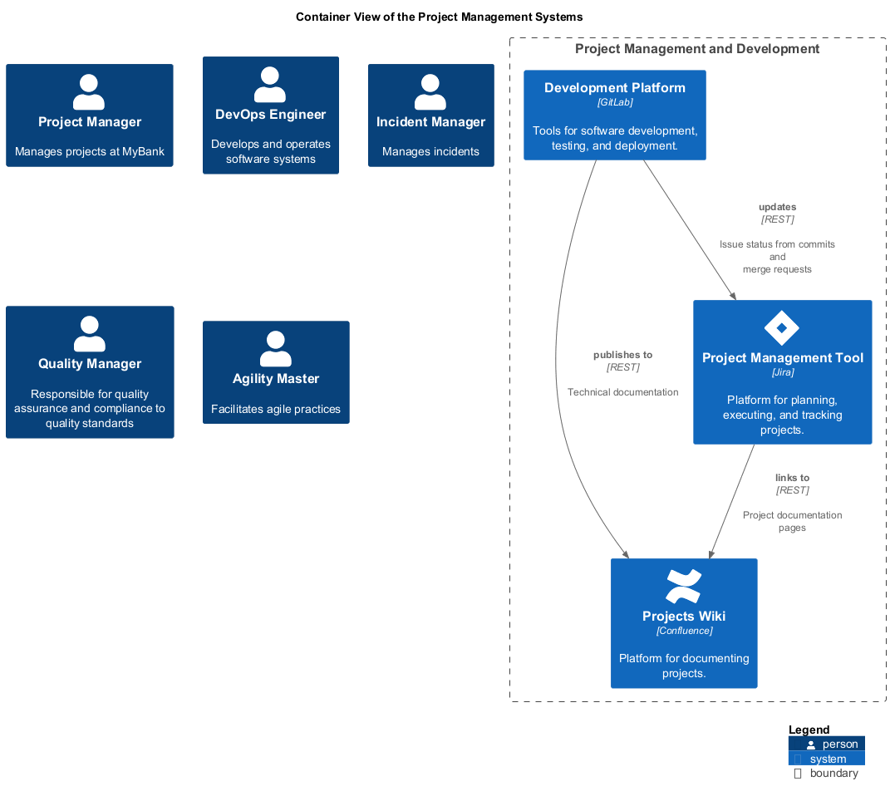

# Project Management and Development (Context-boundary)
## Description
Tools for managing projects and software development.

## Parent
[My Bank](../../mybank/mybank-plc.md)
## Systems
| System | Description |
|---|---|
| [Development Platform](../../mybank/project-management/gitlab.md) | Tools for software development, testing, and deployment. |
| [Project Management Tool](../../mybank/project-management/jira.md) | Platform for planning, executing, and tracking projects. |
| [Projects Wiki](../../mybank/project-management/confluence.md) | Platform for documenting projects. |

## Container View

[Container View of the Project Management Systems](../../mybank/project-management/container-view.md)

## Navigation
[List of views in namespace](./views-in-namespace.md)

[List of all Views](../../views.md)

(generated by [Overarch](https://github.com/soulspace-org/overarch) with template docs/node.md.cmb)
