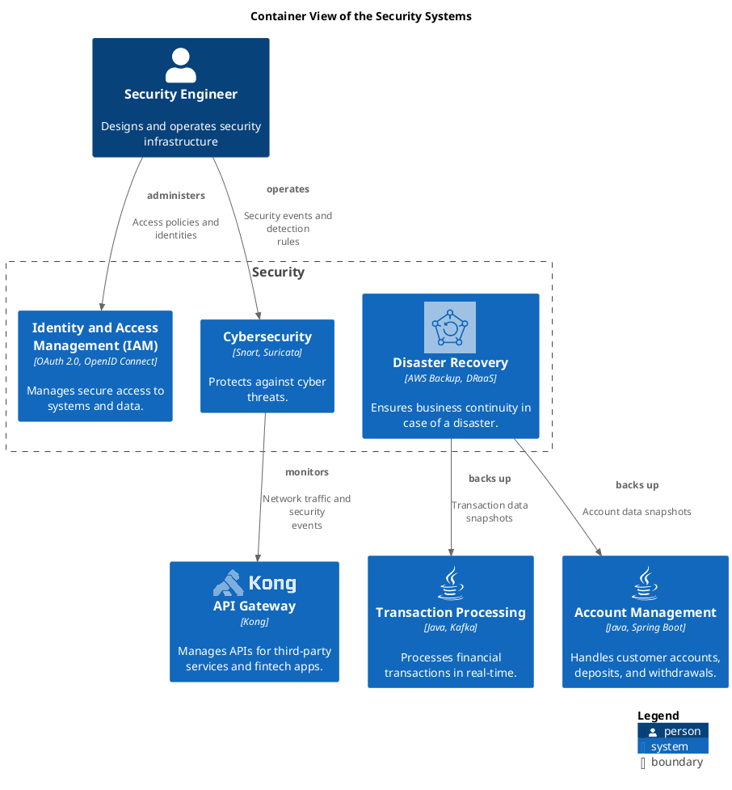

# Security (Context-boundary)
## Description
Ensures the security of systems and data.

## Parent
[My Bank](../../mybank/mybank-plc.md)
## Systems
| System | Description |
|---|---|
| [Cybersecurity](../../mybank/security/cybersecurity-system.md) | Protects against cyber threats. |
| [Disaster Recovery](../../mybank/security/disaster-recovery-system.md) | Ensures business continuity in case of a disaster. |
| [Identity and Access Management (IAM)](../../mybank/security/identity-access-management-system.md) | Manages secure access to systems and data. |

## Container View

[Container View of the Security Systems](../../mybank/security/container-view.md)

## Navigation
[List of views in namespace](./views-in-namespace.md)

[List of all Views](../../views.md)

(generated by [Overarch](https://github.com/soulspace-org/overarch) with template docs/node.md.cmb)
