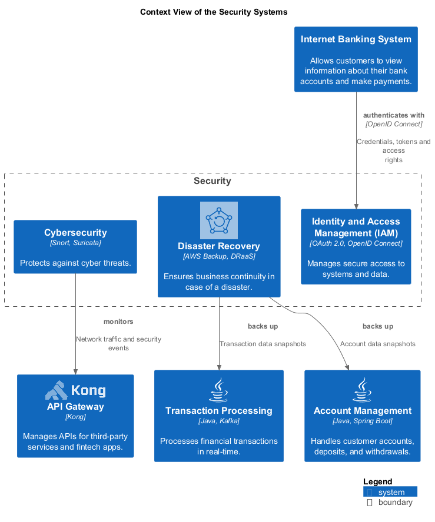

# Identity and Access Management (IAM) (System)
## Description
Manages secure access to systems and data.

## Parent
[Security](../../mybank/security/context-boundary.md)

## Technology
OAuth 2.0, OpenID Connect
## Incoming Synchronous Requests 
| From | Name | To | Technology | Description |
|---|---|---|---|---|
| [Security Engineer](../../mybank/it-management/security-engineer.md) | administers | [Identity and Access Management (IAM)](../../mybank/security/identity-access-management-system.md) |  | Access policies and identities |
| [Internet Banking System](../../mybank/digital-banking/internet-banking-system/internet-banking-system.md) | authenticates with | [Identity and Access Management (IAM)](../../mybank/security/identity-access-management-system.md) | OpenID Connect | Credentials, tokens and access rights |

## System Context View

[Context View of the Security Systems](../../mybank/security/context-view.md)

## Navigation
[List of views in namespace](./views-in-namespace.md)

[List of all Views](../../views.md)

(generated by [Overarch](https://github.com/soulspace-org/overarch) with template docs/node.md.cmb)
